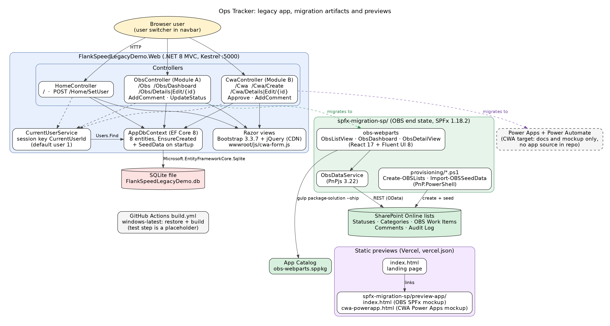

# Ops Tracker architecture

This repository holds three things:

1. **The legacy app**: `FlankSpeedLegacyDemo.Web/`, a .NET 8 MVC app with two modules (OBS and CWA).
2. **The OBS migration end state**: `spfx-migration-sp/`, SPFx web parts backed by SharePoint lists.
3. **Static HTML previews**: the root `index.html` and `spfx-migration-sp/preview-app/`, hosted as a static site on Vercel.

The diagram source is [`diagrams/architecture.dot`](diagrams/architecture.dot) (Graphviz). Run `docs/diagrams/render.sh` after editing it to regenerate [`architecture.png`](diagrams/architecture.png) and [`architecture.svg`](diagrams/architecture.svg).

## Legacy app: `FlankSpeedLegacyDemo.Web/`

| Concern | Implementation |
|---|---|
| Runtime | ASP.NET Core 8 MVC (`Program.cs`), Kestrel. There is no `launchSettings.json`, so `dotnet run` listens on `http://localhost:5000`. |
| UI | Server-rendered Razor views. Bootstrap 3.3.7 and jQuery 3.7.1 load from public CDNs in `Views/Shared/_Layout.cshtml`. `wwwroot/js/cwa-form.js` toggles CWA conditional fields. |
| Data access | EF Core 8 with `Microsoft.EntityFrameworkCore.Sqlite`. `AppDbContext` has 8 `DbSet`s: Users, WorkItems, Categories, Statuses, Comments, Attachments, AuditLogs, ApprovalSteps. |
| Database | One SQLite file, `FlankSpeedLegacyDemo.db`, from `ConnectionStrings:DefaultConnection` in `appsettings.json`. It is created relative to the working directory and is git-ignored (`*.db`). |
| Schema | `Database.EnsureCreated()` at startup. There are no EF migrations in the repo. |
| Seed data | `Data/SeedData.cs` runs on every startup and seeds an empty database with 10 users, 8 categories, 10 statuses, 20 work items (10 OBS, 10 CWA), 28 comments, 10 attachments, 15 audit entries and 8 approval steps. Attachments are metadata rows only; no file storage exists. |
| Auth | None. `Services/CurrentUserService` stores `CurrentUserId` in the ASP.NET Core session (30-minute idle timeout), and defaults to user 1 (Sarah Mitchell, Admin). The navbar user switcher posts to `/Home/SetUser`. |
| API | No JSON API. List filters use GET query strings; write forms POST to MVC actions with anti-forgery tokens. |

Both modules share one `WorkItems` table, told apart by the `Module` column (`"OBS"` or `"CWA"`). Categories and statuses carry a `Module` value too (`Shared` statuses apply to both).

### Routes

| Route | Controller action | Purpose |
|---|---|---|
| `/` | `HomeController.Index` | Status counts for both modules, current user's items, recent audit activity |
| `POST /Home/SetUser` | `HomeController.SetUser` | Switch the mock user |
| `/Obs` | `ObsController.Index` | OBS list filtered by status, category, priority and title search |
| `/Obs/Dashboard` | `ObsController.Dashboard` | Counts by status, priority and team; my queue; overdue items |
| `/Obs/Details/{id}`, `/Obs/Edit/{id}` | `ObsController.Details` / `Edit` | Record detail with comments, attachments, audit log; edit form |
| `POST /Obs/AddComment`, `POST /Obs/UpdateStatus` | `ObsController` | Add a note; change status (sets `ClosedDate` on Completed or Closed) |
| `/Cwa` | `CwaController.Index` | CWA request list filtered by status and title search |
| `/Cwa/Create`, `/Cwa/Edit/{id}` | `CwaController.Create` / `Edit` | Request form with conditional fields |
| `/Cwa/Details/{id}` | `CwaController.Details` | Request detail with approval steps |
| `POST /Cwa/Approve`, `POST /Cwa/AddComment` | `CwaController` | Record an approval decision; add a comment |

### CWA approval routing

`CwaController.Create` sets the status to **Pending Approval** and creates approval steps:

- **Facility Access Request**: Supervisor Review, then Security Clearance Verification.
- **Any other category**: Supervisor Review, then Director Approval.
- **Critical priority** adds a third step, Executive Review, assigned to the first active Admin.

The supervisor is the first active Approver on the Operations team, and the director the first active Approver on Compliance. One **Rejected** decision sets the request to Rejected. When every step is **Approved**, the request becomes Approved. The details view shows Approve and Reject buttons only to the step's assigned approver while the step is Pending.

## OBS migration end state: `spfx-migration-sp/`

| Path | Contents |
|---|---|
| `obs-webparts/` | SPFx 1.18.2 solution (Node 18, React 17, Fluent UI 8, PnPjs 3.22) with three web parts: `ObsListView` (replaces `/Obs`), `ObsDashboard` (`/Obs/Dashboard`) and `ObsDetailView` (`/Obs/Details/{id}`). `gulp bundle --ship && gulp package-solution --ship` produces `sharepoint/solution/obs-webparts.sppkg`. |
| `obs-webparts/src/services/ObsDataService.ts` | PnPjs queries against SharePoint lists, replacing EF Core. |
| `provisioning/` | PnP.PowerShell scripts: `Create-OBSLists.ps1` creates the five lists (Statuses, Categories, OBS Work Items, Comments, Audit Log), `Import-OBSSeedData.ps1` loads sample rows. |
| `power-fx-formulas/` | Mapping of the controller LINQ queries to Power Fx. |
| `docs/` | Before/after comparison, list provisioning reference, and a migration architecture image. |
| `DEPLOYMENT.md` | Provision lists, build the package, upload to the App Catalog, add web parts to pages. |

`gulp serve` opens the hosted workbench at `https://{tenantDomain}/_layouts/workbench.aspx` (`config/serve.json`). The web parts have no mock data source, so they need a SharePoint site with the provisioned lists.

`spfx-migration/` is an earlier copy of the same OBS web parts without the SPFx build config (`gulpfile.js`, `config/config.json`, `package-solution.json`, manifests), provisioning scripts, deployment guide or preview app. `spfx-migration-sp/` is the complete version.

The CWA module's Power Apps target exists only as documentation and the `cwa-powerapp.html` mockup; no Power Apps or Power Automate source is in the repo.

## Static previews

`vercel.json` serves the repository root as a static site (no build command, `cleanUrls`, security headers). The root `index.html` links to two self-contained HTML mockups:

- `spfx-migration-sp/preview-app/index.html`: OBS module as SPFx web parts.
- `spfx-migration-sp/preview-app/cwa-powerapp.html`: CWA module as a Power App with an approval flow.

These are static pages with inline sample data; they do not call the .NET app or SharePoint.

## Tooling

- `.github/workflows/build.yml`: on push and PR to `main`, restores and builds the web project on `windows-latest`. The test step only echoes a placeholder; the repo has no test projects.
- `.github/ISSUE_TEMPLATE/migration-task.md`: issue template for migration tasks.
- `.windsurf/`: Cascade rules and a GitHub MCP config for the Windsurf demo ([DEMO-WALKTHROUGH.md](../DEMO-WALKTHROUGH.md)).
- `.vscode/`: launch, task and extension recommendations.
